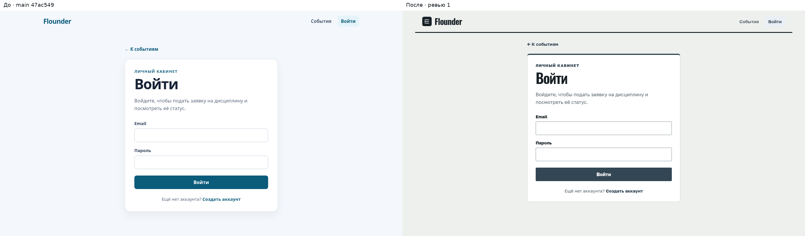
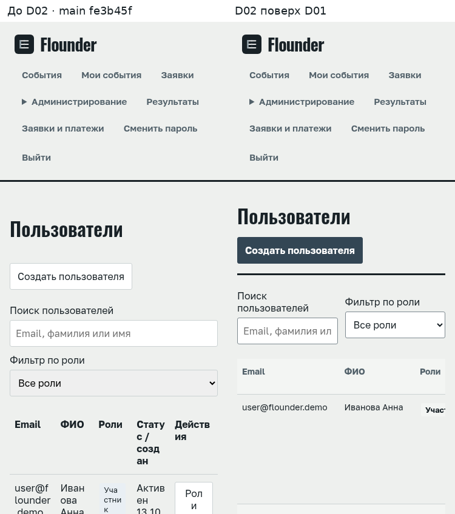
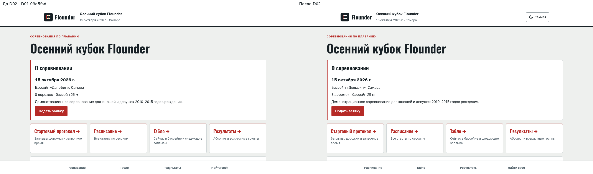
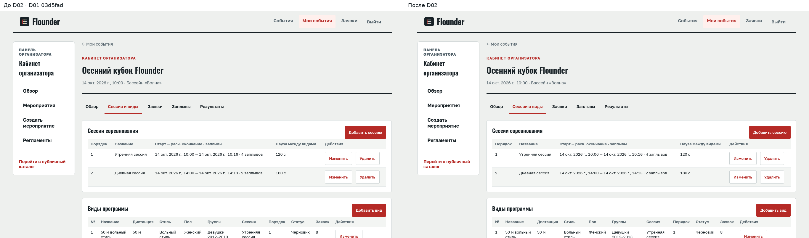
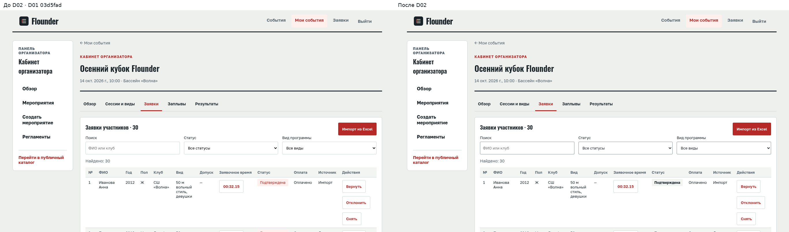
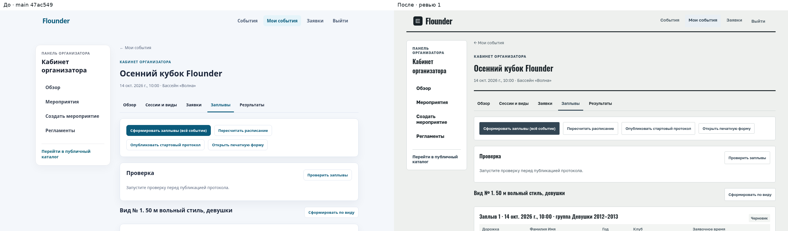
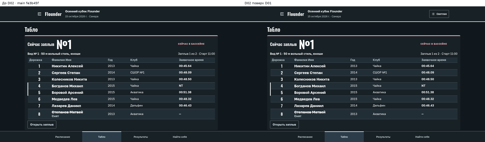
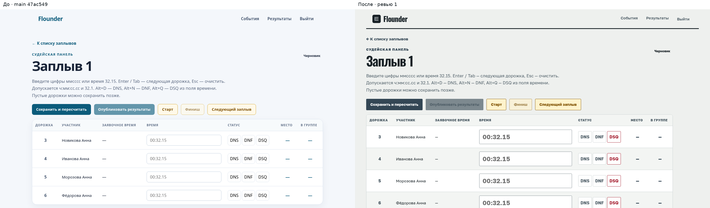

# SportGate — инструкция администратора платформы и организатора

Версия: 15.10.2026. Источник истины — код фронтенда (`sport-platform/frontend/src`) и контракты API (`docs/02_ТЗ_демо.md`, §5). Все названия кнопок, вкладок и статусов взяты из интерфейса без изменений. В шапке интерфейса пока показано старое имя «Flounder» — переименование в SportGate идёт отдельной задачей (S01); в инструкции везде используется SportGate.

Если какой-то функции в интерфейсе ещё нет и она доступна только через API, это отмечено словами **«пока через администратора»** — попросите администратора платформы выполнить действие вручную.

## Оглавление

1. [Роли и кто что видит](#1-роли-и-кто-что-видит)
2. [Первый вход и смена пароля](#2-первый-вход-и-смена-пароля)
3. [Администрирование: пользователи, роли, организации, виды спорта](#3-администрирование-пользователи-роли-организации-виды-спорта)
4. [Площадка и регламент](#4-площадка-и-регламент)
5. [Создание соревнования](#5-создание-соревнования)
6. [Сессии, виды программы, возрастные группы, лимиты](#6-сессии-виды-программы-возрастные-группы-лимиты)
7. [Публикация, открытие и закрытие регистрации](#7-публикация-открытие-и-закрытие-регистрации)
8. [Заявки: статусы, проверка, документы, решения](#8-заявки-статусы-проверка-документы-решения)
9. [Импорт заявок из Excel](#9-импорт-заявок-из-excel)
10. [Посев, заплывы и стартовый протокол](#10-посев-заплывы-и-стартовый-протокол)
11. [День старта: табло, судья, задержки, результаты](#11-день-старта-табло-судья-задержки-результаты)
12. [Письма и настройки уведомлений](#12-письма-и-настройки-уведомлений)
13. [Аналитика и экспорт XLSX](#13-аналитика-и-экспорт-xlsx)
14. [Завершение и архив события](#14-завершение-и-архив-события)
15. [Бэкапы и восстановление](#15-бэкапы-и-восстановление)
16. [Типовые ошибки и что делать](#16-типовые-ошибки-и-что-делать)
17. [FAQ](#17-faq)

---

## 1. Роли и кто что видит

| Роль (код) | Кто это | Что видит в верхнем меню |
|---|---|---|
| Администратор платформы (`platform_admin`) | владелец системы | «События», «Мои события», «Заявки», меню «Администрирование» (Пользователи, Организации, Заявки организаций, Виды спорта), «Результаты», «Заявки и платежи», «Сменить пароль», «Выйти» |
| Организатор (`organizer`) | владелец/администратор организации, главный секретарь | «События», «Мои события», «Заявки», «Сменить пароль», «Выйти» |
| Оператор (`operator`) | секретарь на соревновании | «События», «Результаты», «Заявки и платежи», «Сменить пароль», «Выйти» |
| Судья (`judge`) | судья на финише / секундометрист | «События», «Результаты», «Сменить пароль», «Выйти» |
| Участник (`participant`) | родитель или спортсмен | «События», «Мои заявки», «Сменить пароль», «Выйти» |

Кроме глобальной роли у пользователя есть **роль в организации**: Владелец, Администратор, Участник, Организатор, Оператор, Судья. Настройки уведомлений и аналитика организации доступны только Владельцу и Администратору организации (и администратору платформы).

Кабинет организатора (`/organizer`) открывается ролям `platform_admin`, `organizer`, `operator`. Слева в нём меню: «Обзор», «Мероприятия», «Создать мероприятие», «Регламенты», «Настройки уведомлений», «Аналитика организаций» (последний пункт — только организатор и администратор), внизу ссылка «Перейти в публичный каталог».

---

## 2. Первый вход и смена пароля

**Что сделать → Где это → Что увидите**

1. Получите email и временный пароль от администратора платформы (первый администратор создаётся при развёртывании переменными `APP_ADMIN_EMAIL` / `APP_ADMIN_PASSWORD`, см. `infra/compose.prod.yaml`).
2. Откройте сайт → справа вверху «Войти» → страница «Войти» с полями «Email», «Пароль» → кнопка «Войти».
3. Сразу смените пароль: в верхнем меню «Сменить пароль» → страница «Сменить пароль»: «Текущий пароль», «Новый пароль», «Повторите пароль» → «Сохранить пароль».
   - Требования: не менее 8 символов, обязательно буквы и цифры, не более 72 байт.
   - После смены система **разлогинит вас**: появится текст «Пароль изменён. Войдите заново с новым паролем». Войдите ещё раз.

Если пароль забыт: на странице входа ссылка «Забыли пароль?» → «Восстановить пароль» → введите Email → «Отправить ссылку». Письмо придёт, только если на сервере настроена почта (`MAIL_ENABLED`, см. раздел 12). Ответ всегда одинаковый: «Если аккаунт с этим email существует, мы отправили ссылку восстановления». Администратор может также задать пароль вручную (раздел 3.1).

Ошибки входа:
- «Проверьте email и пароль.» — неверные данные.
- «Аккаунт заблокирован, обратитесь к администратору» — пользователь в статусе «Заблокирован».
- «Слишком много попыток входа. Попробуйте через N мин.» — временная блокировка, подождите.

---

## 3. Администрирование: пользователи, роли, организации, виды спорта

Доступно только администратору платформы, меню «Администрирование».

### 3.1 Пользователи (`/admin/users`)

| Что сделать | Где это | Что увидите |
|---|---|---|
| Найти пользователя | поле «Поиск пользователей» (email, фамилия или имя), «Фильтр по роли» | таблица: Email, ФИО, Роли, Статус / создан, Действия; внизу «Назад» / «Далее», «Страница N · Всего M» |
| Создать пользователя (организатора, судью, оператора) | кнопка «Создать пользователя» | окно «Создать пользователя»: Email, Имя, Фамилия, Дата рождения, Новый пароль, Повторите пароль, «Показать пароль», блок «Роли» (галочки) → «Сохранить» |
| Изменить роли | в строке кнопка «Роли» | окно «Роли пользователя» — галочки глобальных ролей; ниже перечислены роли в отдельных организациях/событиях, они не затрагиваются. При снятии роли администратора нужно поставить галочку «Подтверждаю снятие роли администратора платформы» |
| Заблокировать / разблокировать | кнопка «Заблокировать» или «Разблокировать» | окно «Изменить статус» с вопросом → «Подтвердить». Заблокированный не сможет войти, его токены отзываются |
| Задать пароль вручную | кнопка «Сменить пароль» | окно с «Новый пароль» / «Повторите пароль» → «Сохранить» |

Статусы пользователя: «Активен», «Заблокирован», «Удалён». Себя заблокировать или снять с себя роль администратора нельзя.

Рекомендуемая схема: судье и оператору давайте глобальную роль «Судья» / «Оператор» **и** добавляйте их в организацию с той же ролью (раздел 3.2) — тогда они увидят события организации в «Результаты».

### 3.2 Организации (`/admin/organizations`)

| Что сделать | Где это | Что увидите |
|---|---|---|
| Создать организацию | «Создать организацию» | окно: Название, Тип организации (Клуб / Школа / Федерация / Другое), Город, Юридическое название, ИНН, Контактный email, Контактный телефон → «Создать» |
| Открыть организацию | клик по названию в таблице | страница организации: таблица участников (Email, ФИО, Роль в организации, Действия) и список «События организации» |
| Добавить человека в организацию | «Добавить участника» | окно «Добавить участника»: «Email пользователя» (пользователь должен уже существовать), «Роль в организации» → «Сохранить» |
| Поменять роль / убрать | «Изменить роль» / «Удалить» в строке | окно подтверждения → «Сохранить» / «Удалить» |

В таблице организаций: Название, Город, Владелец (email), Членов / события.

### 3.3 Заявки организаций (`/admin/registration-requests`)

Очередь самостоятельных заявок на регистрацию организации (подаются через API; формы в интерфейсе пока нет). Карточка: название, тип/юрлицо, ИНН, контакты, дата. Кнопки «Одобрить» (создаёт организацию, заявитель становится Владельцем) и «Отклонить» (обязательна «Причина отклонения»). Если очередь пуста: «Заявок организаций на рассмотрении нет».

### 3.4 Виды спорта (`/admin/sports`)

Только просмотр: таблица Код, Название, Активен (Да/Нет). Добавление вида спорта и **шаблонов дисциплин** (используются при добавлении вида программы) — **пока через администратора** (API `/api/v1/sports`, `/api/v1/discipline-templates`; в демо заполнено seed-данными).

### 3.5 Рассмотрение заявки по ID (`/admin/registrations/review`, `/organizer/registrations/review`)

Пункт «Заявки» в верхнем меню — старая форма «Рассмотрение заявки»: ввод «ID заявки», выбор «Подтвердить» / «Запросить уточнение» / «Отклонить», обязательный «Комментарий для участника», кнопка «Сохранить решение». Удобнее работать со вкладкой «Заявки» внутри события (раздел 8); эта страница нужна, когда известен только ID.

---

## 4. Площадка и регламент

### 4.1 Площадка (бассейн)

У каждого соревнования обязательна площадка: название, город, **часовой пояс** (`timezone`, например `Europe/Samara`), число дорожек и длина бассейна. По часовому поясу площадки показываются все времена на публичных страницах, в расписании и аналитике.

Формы создания площадки в интерфейсе **пока нет — создаётся через администратора** (`POST /api/v1/venues`, роль администратора или организатора). В форме создания события площадка выбирается из списка «Площадка»; если список пуст, вы увидите подсказку «Доступные площадки не найдены» и кнопка создания будет недоступна.

### 4.2 Регламент

Регламент обязателен для события и должен быть **опубликован**.

Кабинет организатора → «Регламенты» (`/organizer/regulations/create`) → страница «Новый регламент»:
- «Основные сведения»: Вид спорта, Код регламента, Название, Описание.
- «Версия и правила»: Номер версии, Действует с, Правила (каждое правило с новой строки), Примечание к версии.
- Кнопка «Создать и опубликовать» — регламент сразу публикуется и появляется в списке «Версия регламента» при создании события.

Редактирования и списка регламентов в интерфейсе нет — только создание новой версии.

---

## 5. Создание соревнования

Кабинет организатора → «Создать мероприятие» (`/organizer/events/new`) → страница «Создание мероприятия».

| Блок | Поля | Примечания |
|---|---|---|
| Основные данные | Название, Описание | описание показывается на публичной странице |
| Даты | Открытие регистрации, Закрытие регистрации, Начало события, Окончание события | вводятся в **местном времени вашего браузера**; проверки: закрытие не раньше открытия, начало не раньше закрытия регистрации, окончание не раньше начала |
| Связанные сущности | Организация, Площадка, Вид спорта, Версия регламента (рядом ссылка «Создать регламент») | все четыре списка должны быть непустыми, иначе кнопка «Создать мероприятие» недоступна |
| Внизу | «Лимит участников события (необязательно)», кнопки «Отмена» и «Создать мероприятие» | лимит — число уникальных спортсменов; пусто = «Без лимита» |

После создания: «Мероприятие «…» успешно создано.» и переход в «Мои мероприятия». Событие появится в статусе «Черновик».

Поле часового пояса в форме события нет — оно берётся из площадки.

Страница события внутри кабинета (`/organizer/events/:id`) имеет вкладки: «Обзор», «Сессии и виды», «Заявки», «Заплывы», «Результаты», «Уведомления», «Аналитика» (только организатор/админ). Ссылка «← Мои события» возвращает к списку.

---

## 6. Сессии, виды программы, возрастные группы, лимиты

Вкладка «Сессии и виды».

### 6.1 Сессии

«Добавить сессию» → окно «Добавить сессию»: Название, «Дата и время старта (местное время)», Порядок, «Пауза между видами, секунды» → «Сохранить сессию». В таблице сессий: Порядок, Название, «Старт — расч. окончание · заплывы» (расчёт появится после формирования заплывов), «Пауза между видами», действия «Изменить» / «Удалить». Пустая таблица: «Добавьте первую сессию».

Сессию нужно создать **до** видов программы — вид обязательно привязывается к сессии.

### 6.2 Виды программы

«Добавить вид» → боковая панель «Добавить вид программы»:

| Поле | Значения |
|---|---|
| Шаблон | обязательный выбор из шаблонов дисциплин вида спорта события; если пусто — «Для вида спорта события нет шаблонов дисциплин» (нужен администратор) |
| Код вида (необязательно) | например `F-50-FREE`; именно этот код указывается в Excel-импорте |
| Название (необязательно) | «Формируется автоматически», например «50 м вольный стиль, девушки» |
| Дистанция | 25, 50, 100, 200, 400, 800, 1500 м |
| Стиль | Вольный стиль, На спине, Брасс, Баттерфляй, Комплекс |
| Пол | Женский, Мужской, Смешанный |
| Режим посева | «По возрастным группам» или «Абсолютный» |
| Сессия, Порядок в сессии | порядок задаёт номер вида и очередность заплывов |
| Длительность заплыва, секунды (необязательно) | иначе берётся таблица по дистанции |
| Лимит участников вида | пусто = без лимита |
| Возрастные группы | «Добавить пресет» → выбрать «Пресет» → «Применить пресет»; или «Добавить группу вручную» (Код, Название, Пол (M/F/X), От года, До года, «Лимит группы»); «Удалить группу» |

Кнопка «Сохранить вид». В таблице видов: №, Название (и код), Дистанция, Стиль, Пол, Группы, Сессия, Порядок, Статус, Заявок, Действия («Изменить», «Удалить», «Опубликовать вид»).

**Важно:** участники видят в форме заявки только виды со статусом «Опубликовано» — нажмите «Опубликовать вид» для каждого вида перед открытием регистрации. У вида с лимитом в таблице показывается бейдж «Лимит: занято/лимит».

### 6.3 Лимиты и лист ожидания

Три уровня лимитов: событие (уникальные спортсмены; задаётся при создании или на вкладке «Обзор» — поле «Лимит участников события» → «Сохранить лимит»), вид (заявки) и возрастная группа (заявки). Действует самый строгий.

Когда лимит заполнен, новая публичная заявка получает статус «Лист ожидания» с номером очереди (в таблице заявок показывается «Лист ожидания · № 3»). Очередь продвигается автоматически: при снятии, отклонении, возврате на исправление другой заявки или при повышении лимита первая подходящая заявка переходит в «На рассмотрении». Организатор может подтвердить заявку из очереди вручную кнопкой «Подтвердить вне лимита». Заявки из листа ожидания не попадают в посев. Импорт из Excel лимиты обходит (заявки сразу «Подтверждена»).

---

## 7. Публикация, открытие и закрытие регистрации

Вкладка «Обзор» → карточка «Информация о событии». Текущий статус показан бейджем, рядом кнопка следующего шага. Каждое нажатие требует подтверждения в окне «Подтвердите изменение статуса события».

| Статус события | Доступная кнопка | Что происходит |
|---|---|---|
| Черновик | «Опубликовать» | событие появляется в публичном каталоге «События» и по ссылке `/e/<slug>` |
| Опубликовано | «Открыть регистрацию» | участники видят кнопку «Подать заявку» |
| Регистрация открыта | «Закрыть регистрацию» | приём заявок останавливается; закрытие также происходит автоматически по дате «Закрытие регистрации» |
| Регистрация закрыта | «Продлить» (нужно заполнить «Новая дата закрытия регистрации» в будущем) или «Завершить соревнование» | продление снова открывает приём |
| Идёт соревнование | «Завершить соревнование» | результаты зафиксированы |
| Завершено | «В архив» | только просмотр, см. раздел 14 |

Там же: даты, площадка («8 дорожек · 25 м»), «Лимит: занято/лимит», показатели «Заявок всего», «Подтверждено», «Оплачено», «Заплывов сформировано», «Заплывов опубликовано», и карточка «Публичная страница» с ссылкой, кнопкой «Копировать» («Ссылка скопирована») и QR-кодом — его удобно напечатать для стенда у бассейна.

Редактирование названия, описания и дат события после создания в интерфейсе недоступно (кроме лимита и даты закрытия при продлении) — **пока через администратора** (`PATCH /api/v1/events/{id}`).

---

## 8. Заявки: статусы, проверка, документы, решения

Вкладка «Заявки» (`/organizer/events/:id/entries`). Заголовок «Заявки участников · N».

Фильтры: «Поиск» (ФИО или клуб), «Статус» (включая «Не допущены»), «Вид программы», галочка «Нет справки». Ниже «Найдено: N».

Колонки таблицы: №, ФИО, Год, Пол, Клуб, Вид, Допуск, Документы, Заявочное время, Статус, Оплата, Источник, Действия.

### 8.1 Статусы заявки

| Статус в интерфейсе | Код | Что означает | Кто меняет |
|---|---|---|---|
| Лист ожидания | WAITLISTED | мест нет, заявка в очереди (показан № в очереди) | система / «Подтвердить вне лимита» |
| На рассмотрении | SUBMITTED | подана участником, ждёт решения | участник подаёт |
| Подтверждена | CONFIRMED | допущена, можно оплачивать | «Подтвердить»; импорт даёт сразу этот статус |
| Оплачено | PAID | оплата получена | «Оплачено», оператор или ЮKassa |
| Допущена | ADMITTED | допуск отмечен вручную | API |
| На исправлении | NEEDS_CORRECTION | возвращена участнику с комментарием | «Вернуть» |
| Отклонена | REJECTED | не допущена | «Отклонить» |
| Снята | WITHDRAWN | снята организатором/участником | «Снять» |
| Отменена | CANCELLED | отменена | API |

Оплата: «Ожидает оплаты», «Оплачено», «Без оплаты» (взнос 0), «Возврат оплаты». Источник: «Форма» (публичная заявка) или «Импорт».

### 8.2 Решения по заявке

| Кнопка | Когда видна | Что происходит |
|---|---|---|
| «Подтвердить» / «Подтвердить вне лимита» | На рассмотрении, Лист ожидания | окно «Подтвердить заявку», поле «Комментарий» (необязательно) → «Сохранить решение». Участнику уходит письмо «Заявка подтверждена» |
| «Вернуть» | На рассмотрении | окно «Вернуть на исправление», комментарий обязателен. Участник увидит статус «Требует уточнения» и комментарий |
| «Отклонить» | все, кроме снятых/отклонённых/оплаченных/допущенных | окно «Отклонить заявку», комментарий обязателен. Письмо «Заявка отклонена» |
| «Оплачено» | Подтверждена и не оплачена | отметка ручной оплаты без платёжной записи (демо) |
| «Снять» | кроме снятых/отклонённых/оплаченных/допущенных | окно «Снять заявку?». Если по виду уже есть заплывы, появится напоминание «Пересчитайте заплывы · Заплывы» |

Участник исправить заявку сам не может: после «Вернуть» он должен связаться с вами, а вы правите данные (заявочное время — прямо в таблице, остальное — через повторную подачу после «Снять»).

### 8.3 Заявочное время

В колонке «Заявочное время» — кнопка со значением (или «—»). Нажмите, введите в формате `сс.сс` или `м:сс.сс` (например `32.15` или `1:05.40`), «Сохранить» / «Отмена». Пустое значение = без времени (NT), такие заявки сеются в конец.

### 8.4 Допуск

Колонка «Допуск» заполняется **после формирования заплывов** (подсказка «Сформируйте заплывы, чтобы проверить допуск»). ✓ — допущена; иначе код причины с подсказкой при наведении:
- `GENDER_MISMATCH` — пол участника не соответствует виду программы;
- `AGE_GROUP_MISMATCH` — год рождения не соответствует возрастным группам;
- `DUPLICATE_ENTRY` — участник уже заявлен на этот вид;
- `ATHLETE_NOT_FOUND` — спортсмен не найден в справочнике.
Фильтр «Не допущены» показывает только такие строки.

### 8.5 Документы участника

Колонка «Документы» — четыре значка в порядке: Медицинская справка, Страховка, Согласие родителя, Согласие на обработку ПДн. ✓ принят, ◷ на проверке, ✕ отклонён, — не загружен. Клик открывает окно «Документы · Фамилия» со списком и кнопкой «Скачать» для каждого файла; организатор может и загрузить документ за участника («Тип документа», «Файл документа», «Дата выдачи», «Действует до» → «Загрузить документ»; PDF/JPG/PNG до 10 МБ).

Под значками могут появляться предупреждения, например что справка истекает раньше старта. Предупреждения **не блокируют** посев.

Перевод документа в «Принят» / «Отклонён» в интерфейсе пока отсутствует (экран комиссии не реализован, см. `docs/M04-participant-documents.md`) — все загруженные документы остаются «На проверке». Удалить ошибочный файл организатор тоже не может — только участник, пока документ «На проверке».

### 8.6 Оператор: «Заявки и платежи»

Оператор и администратор видят в верхнем меню «Заявки и платежи» (`/operator/payments`): таблица Заявка, Событие, Статус → «Открыть». На странице «Заявка участника»: данные, блок «Оплата» с кнопкой «Подтвердить ручную оплату» (ЮKassa подтверждается автоматически), блок «Решение по заявке» с кнопками «Подтвердить заявку», «Запросить уточнение», «Отклонить заявку» (решение — организатор или администратор; оператор только подтверждает оплату).

---

## 9. Импорт заявок из Excel

Вкладка «Заявки» → «Импорт из Excel» → окно «Импорт заявок из Excel».

1. «Скачать шаблон» — файл `.xlsx` с колонками строго в таком порядке: `Фамилия | Имя | Отчество | Дата рождения (ДД.ММ.ГГГГ) | Пол (М/Ж) | Клуб/Город | Дисциплина (код) | Заявочное время (мм:сс.сс или пусто)`.
2. Заполните: одна строка = одна заявка на один вид; спортсмен на три вида — три строки. «Дисциплина (код)» — код вида из таблицы «Виды программы» (например `F-50-FREE`).
3. «Файл .xlsx» → выберите файл → «Импортировать». Во время загрузки — «Импортируем заявки…».
4. «Отчёт импорта»: «Всего · Создано · Обновлено · Пропущено · Новых профилей», «Ошибок: N» и таблица Строка / Колонка / Сообщение. Ошибочные строки пропускаются, остальные загружаются.
5. «Закрыть и обновить».

Правила: импортированные заявки получают статус «Подтверждена», источник «Импорт», оплата «Без оплаты» при взносе 0. Повторный импорт того же файла обновляет существующие заявки, а не дублирует; после «Снять» повторный импорт создаёт новую заявку. Спортсмен определяется по ФИО + дата рождения + пол; если родитель позже регистрирует аккаунт с теми же данными, профиль привязывается к аккаунту автоматически.

Тестовые наборы: `docs/scripts/demo/out/set-M.xlsx` (200 заявок) и `set-M-with-errors.xlsx` (с тремя ошибочными строками).

---

## 10. Посев, заплывы и стартовый протокол

Вкладка «Заплывы» (`/organizer/events/:id/heats`).

### 10.1 Формирование

| Кнопка | Действие |
|---|---|
| «Сформировать заплывы (всё событие)» | посев по всем видам сразу; в посев идут только подтверждённые/оплаченные заявки, подходящие по полу и группе |
| «Сформировать по виду» (у каждого вида) | пересев одного вида |
| «Пересчитать расписание» | расставляет время старта каждого заплыва по сессиям с учётом длительности и пауз |
| «Проверить заплывы» (карточка «Проверка») | независимый валидатор; «Нарушений не найдено.» или список «Ошибка: …» / «Предупреждение: …» — клик подсвечивает нужный заплыв |
| «Опубликовать стартовый протокол» | заплывы переходят в статус «Опубликовано», появляются на публичных страницах, участникам уходит письмо |
| «Открыть печатную форму» | публичная страница `/e/<slug>/start-list?print=1` для печати из браузера |
| «Скачать PDF» | серверный PDF «Стартовый-протокол.pdf» |
| «Сдвинуть расписание…» | см. раздел 11.3 |

Если заплывы уже опубликованы, повторное формирование спросит «Переформировать опубликованные заплывы?» — после подтверждения протокол нужно опубликовать заново.

Блок «Последнее формирование»: «Длительность: N мс · Исключено заявок: N» и список предупреждений (например, малая группа, участник без времени).

Галочка «Круговой посев трёх сильнейших заплывов» в интерфейсе **выключена и недоступна** («Настройка доступна только для просмотра»). Круговой посев можно включить **пока через администратора** параметром `circleSeedTopHeats: true` в `POST /api/v1/event-disciplines/{id}/generate-competition-units`.

### 10.2 Карточки заплывов

Для каждого вида: «Вид № 3. 50 м вольный стиль, девушки», затем карточки «Заплыв 2 · 12 окт. 2026 г., 10:03 · группа …» со статусом и таблицей Дорожка / Фамилия Имя / Год / Клуб / Заявочное время. Дорожку можно поменять селектом прямо в строке (конфликт дорожек вернёт ошибку). Если у площадки не задано число дорожек, селект покажет подсказку «Число дорожек площадки не указано».

Статусы заплыва в кабинете организатора: «Черновик», «В расписании», «Опубликовано» (стартовый протокол), «Идёт заплыв», «Завершён». В судейской панели и списке «Результаты» те же статусы названы иначе: «Запланирован», «Стартовый протокол опубликован», «Идёт заплыв», «Завершён, результаты опубликованы», «Завершён», «Отменён».

### 10.3 Порядок действий перед стартом

1. Закрыть регистрацию → разобрать «На рассмотрении» и «Лист ожидания».
2. «Сформировать заплывы (всё событие)» → «Пересчитать расписание» → «Проверить заплывы».
3. Вручную поправить дорожки при необходимости → снова «Проверить заплывы».
4. «Опубликовать стартовый протокол» → «Скачать PDF» для печати и выдачи судьям.
5. Проверить на вкладке «Уведомления», что письма «Стартовый протокол опубликован» ушли.

---

## 11. День старта: табло, судья, задержки, результаты

### 11.1 Живое табло

Публичная страница «Табло» (`/e/<slug>/live`) показывает «Сейчас в бассейне»: «Сейчас заплыв №…», вид, «Заплыв N из M · Старт …», ссылку «Открыть заплыв»; блок «Далее» — следующие заплывы; «Найти себя»; обновление каждые 5 секунд. При задержке появляется строка «Соревнование идёт с задержкой N мин, время рассчитано с учётом задержки».

Текущий заплыв на табло переключается кнопками «Финиш» и «Следующий заплыв» в судейской панели.

### 11.2 Судейская панель

Путь: верхнее меню «Результаты» (`/operator/results`) → «Событие» → «Вид программы» → «Заплыв» → «Открыть». Либо из кабинета организатора: вкладка «Результаты» → ссылка «Ввести» в строке заплыва.

Страница «Судейская панель» (`/operator/competition-units/:unitId`):
- Таблица Дорожка / Участник / Заявочное время / Время / Статус / Место / В группе.
- Ввод времени: цифры `ммсссс` или `32.15`; Enter / Tab — следующая дорожка, Esc — очистить. Кнопки DNS / DNF / DSQ у каждой дорожки (Alt+D, Alt+N, Alt+Q из поля времени). Пустые дорожки можно сохранить позже.
- Кнопки: «Старт» (заплыв → «Идёт заплыв», фиксируется фактическое время старта), «Сохранить и пересчитать» (сохраняет времена, считает места), «Опубликовать результаты» (заплыв → «Завершён, результаты опубликованы», результаты видны публично, участникам письмо), «Финиш» (заплыв завершён, табло переходит к следующему), «Следующий заплыв» (открывает следующий по расписанию и переводит табло).
- Строка состояния: «Есть несохранённые изменения» / «Сохранено 10:42». Пока есть несохранённые изменения, кнопки публикации, старта и финиша недоступны — сначала «Сохранить и пересчитать».

Судья **может** публиковать результаты, но **не может** снимать их с публикации и править после публикации.

### 11.3 Задержки и сдвиг расписания

Фактическое отставание считается автоматически: как только судья нажал «Старт» позже планового времени, на табло и во вкладке «Заплывы» появляется «Отставание: +N мин» (иначе «Идём по расписанию»). Плановое время заплывов при этом не меняется, участники видят «Расчётное время старта».

Если нужно реально перенести оставшиеся заплывы: вкладка «Заплывы» → «Сдвинуть расписание…» → окно «Сдвинуть расписание»: «С какого заплыва», «Сдвиг в минутах» (положительное — позже, отрицательное — раньше, до 1440). Ниже предпросмотр: «Первый заплыв: 10:03 → 10:23», «Последний заплыв: …», «Будет сдвинуто заплывов: N» → «Подтвердить сдвиг». Начатые и завершённые заплывы не сдвигаются; при наложении следующая сессия того же дня сдвигается автоматически. На публичном «Расписании» появится строка «Расписание сдвинуто в ЧЧ:ММ».

### 11.4 Публикация результатов и исправления (CORRECTED)

Вкладка «Результаты» в кабинете (`/organizer/events/:id/results`): по каждому виду таблица Заплыв / Время / Статус / Результаты («Нет», «Внесены», «Опубликованы») / Действия («Ввести»). Кнопка «Опубликовать результаты вида» становится активной, когда во всех заплывах вида внесены все результаты. Вверху «Печать итогового протокола» (браузерная) и «Скачать PDF» («Итоговый-протокол.pdf»).

Исправление после публикации (только оператор, организатор, администратор): открыть заплыв в судейской панели → изменить время или статус → «Сохранить исправление». У исправленной дорожки появляется пометка «исправлено» (статус результата `CORRECTED`), места пересчитываются, публичные результаты обновляются (публичный PDF может отставать до 60 секунд). Кнопка «Снять результаты с публикации» возвращает заплыв в «Стартовый протокол опубликован» — после правок опубликуйте заново.

Публичные «Результаты» (`/e/<slug>/results`): переключатель «Абсолют» / «По группам», «Печать», «Скачать PDF».

---

## 12. Письма и настройки уведомлений

Письма отправляются через SMTP, настроенный на сервере (`MAIL_ENABLED`, `MAIL_HOST`, `MAIL_FROM` и др., см. `docs/M05-notifications.md`). Без настройки почты письма остаются в журнале со статусом «Ожидает отправки» либо пишутся в лог сервера (dev-режим).

### 12.1 Какие письма уходят

| Письмо | Когда |
|---|---|
| Заявка принята | участник подал заявку (и при продвижении из листа ожидания) |
| Заявка подтверждена | организатор нажал «Подтвердить» |
| Заявка отклонена | организатор нажал «Отклонить» (с причиной) |
| Стартовый протокол опубликован | «Опубликовать стартовый протокол» — только участникам, попавшим в заплывы |
| Результаты опубликованы | «Опубликовать результаты» по заплыву — участникам этого заплыва |
| Восстановление пароля | запрос «Забыли пароль?»; отключить нельзя |

Писем о снятии заявки, о попадании в лист ожидания и о закрытии регистрации пока нет.

### 12.2 Настройки

Кабинет организатора → «Настройки уведомлений» (`/organizer/notification-settings`): выберите «Организация», в блоке «Письма участникам» снимите галочки с ненужных типов → «Сохранить» («Настройки сохранены.»). Доступно Владельцу и Администратору организации; остальные увидят ошибку доступа. Изменение действует на будущие письма.

### 12.3 Журнал

Вкладка «Уведомления» события: фильтр «Статус» («Ожидает отправки», «Отправлено», «Ошибка отправки»), «Обновить», таблица Создано / Адресат / Письмо / Статус / Попытки / Отправлено / Ошибка, страницы «Назад» / «Далее». Тексты писем в журнале не хранятся. Повторная отправка писем со статусом «Ошибка отправки» из интерфейса невозможна (после 5 неудачных попыток письмо остаётся в ошибке).

---

## 13. Аналитика и экспорт XLSX

Вкладка «Аналитика» события (организатор и администратор платформы): карточки «Всего заявок», «Участники», воронка «Подано → Подтверждено → Оплачено / без взноса → Допущено в посев», «Заявки по дням» (график и «Показать значения по дням»), «Заявки по статусам», «По видам», «По возрастным группам», «По клубам — топ-20 и прочие», «Загрузка сессий», «Время от финиша до публикации», «Последний прогон валидатора», «Последние импорты». Кнопки «Обновить» и «Скачать XLSX» (12 листов). Данные обновляются не чаще раза в минуту, время — в часовом поясе площадки.

«Аналитика организаций» (меню кабинета) → список организаций → «Открыть аналитику» → «События», «Участия в событиях», «Уникальные / повторные», «События по статусам», «Выручка по оплатам», «Скачать XLSX» (3 листа). Доступно Владельцу и Администратору организации; иначе «Доступно владельцам и администраторам организации».

Подробные определения метрик: `docs/analytics/M08-analytics.md`.

---

## 14. Завершение и архив события

1. После публикации всех результатов: вкладка «Обзор» → «Завершить соревнование» → подтвердить. Статус «Завершено».
2. «В архив» → подтвердить. Статус «В архиве»; вверху страницы события появится «Событие в архиве. Доступен только просмотр.» — все кнопки редактирования отключены, публичные страницы (протоколы, результаты, PDF) продолжают работать.

Вернуть событие из архива нельзя.

---

## 15. Бэкапы и восстановление

Выполняются на сервере, не из интерфейса. Скрипты в `infra/`:
- `infra/backup.sh` — ежедневный дамп PostgreSQL (custom-формат) + архив тома с документами участников; хранение 30 суток; расписание в `infra/crontab.example` (часовой пояс Europe/Moscow).
- `infra/verify-latest-backup.sh` — проверка последнего бэкапа восстановлением в отдельную тестовую базу.
- `infra/restore.sh`, `infra/restore-production.sh` — восстановление (production-вариант останавливает API, делает свежий бэкап и только потом восстанавливает).
- `infra/alert.sh`, `infra/check-disk.sh` — оповещения о сбое бэкапа и месте на диске.

Ключ шифрования документов `APP_FILES_ENCRYPTION_KEY` **не входит в бэкап** — храните его отдельно; без ключа загруженные документы участников не восстановить. Подробности: `docs/m09-verification.md`, `docs/M04-participant-documents.md`, `docs/runbook-demo.md`.

---

## 16. Типовые ошибки и что делать

| Что видите | Причина | Что делать |
|---|---|---|
| Кнопка «Создать мероприятие» неактивна, подсказки «Доступные площадки не найдены» / «Нет опубликованных регламентов» / «Для вашей учётной записи нет доступных организаций» | нет площадки, регламента или вы не состоите в организации | попросите администратора создать площадку (раздел 4.1) и добавить вас в организацию; создайте регламент через «Регламенты» |
| «Нет доступа к кабинету организатора.» | у аккаунта нет роли организатора/оператора/администратора | администратор → «Пользователи» → «Роли» |
| «Нет доступа к этому событию.» | событие другой организации | добавить вас в организацию события |
| Участник не видит вид в форме заявки | вид не опубликован или не подходит по полу/году | «Опубликовать вид»; проверить возрастные группы |
| «Подать заявку» не показывается на публичной странице | статус события не «Регистрация открыта» или дата закрытия прошла | «Открыть регистрацию» или «Продлить» с новой датой |
| «Для вида спорта события нет шаблонов дисциплин» | в справочнике нет шаблонов | пока через администратора (API `discipline-templates`) |
| Колонка «Допуск» показывает «—» | заплывы ещё не формировались | «Сформировать заплывы» |
| «Переформировать опубликованные заплывы?» | протокол уже опубликован | подтвердить, затем заново «Опубликовать стартовый протокол» |
| В судейской панели серые кнопки «Опубликовать результаты» / «Финиш» | есть несохранённые изменения или заполнены не все дорожки | «Сохранить и пересчитать»; заполнить время или DNS/DNF/DSQ по каждой дорожке |
| «Следующий заплыв открыт, но табло не обновлено…» | не удалось обновить live-состояние | повторить «Следующий заплыв» или обновить страницу табло |
| «Сессия истекла. Войдите в систему снова.» | истёк токен | войти заново |
| Ошибка импорта «неверный формат, ожидается ДД.ММ.ГГГГ» / неизвестный код дисциплины / пустая фамилия | ошибки в строках Excel | исправить указанные строки и импортировать снова (повтор безопасен) |
| «Размер документа превышает 10 МБ.» / «Разрешены только PDF, JPG и PNG.» | неподходящий файл документа | сжать или сконвертировать файл |
| «Не удалось скопировать. Выделите ссылку и скопируйте вручную.» | браузер запретил доступ к буферу | скопировать ссылку вручную |
| Письма «Ожидает отправки» и не уходят | на сервере не настроен SMTP | проверить `MAIL_ENABLED`, `MAIL_HOST` (`docs/M05-notifications.md`) |
| «Документ занят» / 503 при скачивании PDF | одновременно генерируется более двух PDF | повторить через несколько секунд |

---

## 17. FAQ

**Можно ли изменить дату или название события после создания?** В интерфейсе — нет (только лимит и, при продлении, дата закрытия регистрации). Пока через администратора.

**Как добавить судью на соревнование?** Администратор создаёт пользователя с ролью «Судья» («Пользователи» → «Создать пользователя») и добавляет его в организацию («Организации» → организация → «Добавить участника», роль «Судья»). Судья входит, открывает «Результаты», выбирает событие, вид и заплыв.

**Как родителю зарегистрировать второго ребёнка?** Сейчас один аккаунт = один спортсмен (профиль привязан к аккаунту и перезаписывается данными из формы). Для второго ребёнка нужен отдельный аккаунт с другим email либо импорт из Excel организатором.

**Что видит зритель без входа?** Каталог «События», страницу события, «Стартовый протокол», «Расписание», «Табло», «Результаты», «Найти себя», PDF-протоколы.

**Почему участник из листа ожидания не попал в заплывы?** Заявки «Лист ожидания» в посев не идут. Нажмите «Подтвердить вне лимита» или повысьте лимит, затем переформируйте заплывы.

**Как напечатать протокол?** «Скачать PDF» (серверный, одинаковый у всех) либо «Открыть печатную форму» / «Печать» в браузере (A4, портрет).

**Нужен ли интернет участникам на табло?** Табло работает как PWA: при обрыве связи показывает последние данные с пометкой «Нет связи, показаны последние данные» и обновится после подключения.

## Обновление S05: заполнение взносов после деплоя

Для событий с существующими CONFIRMED/PAID заявками откройте «Оплата» → **«Заполнить взносы старых заявок»**, предварительно проверив настройки взносов и суммы видов программы. Это нужно сделать до отметки оплаты старых заявок: иначе `mark-paid` без суммы записывает `paid_amount=null`, и сводка показывает «оплачено 0». Операция повторяемая, ранее зафиксированные суммы и оплаты сохраняются. Подробнее: [оплата заявок S05](../12_Инструкция_администратора.md).
