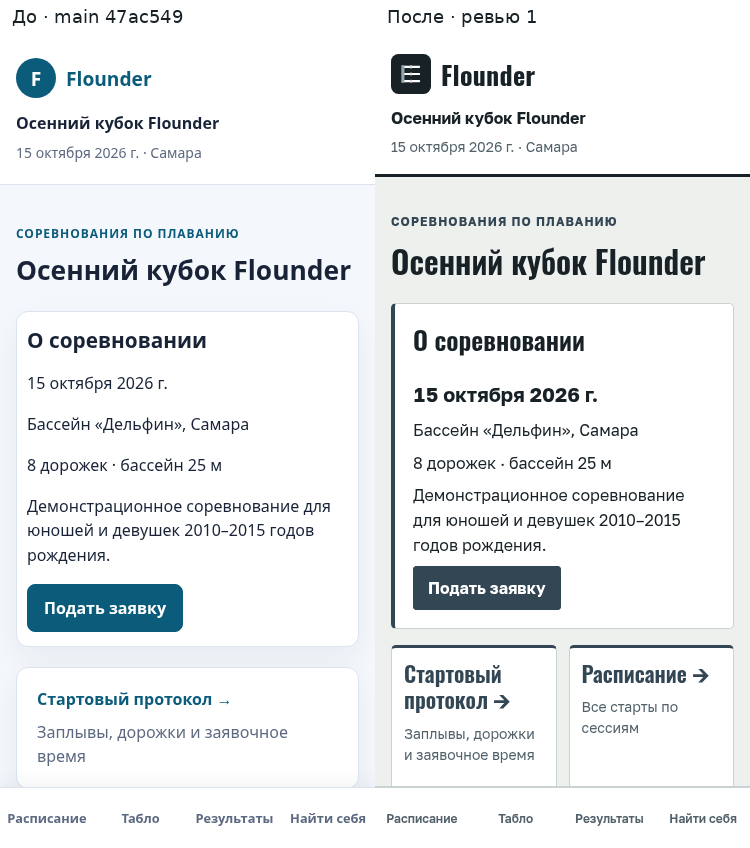
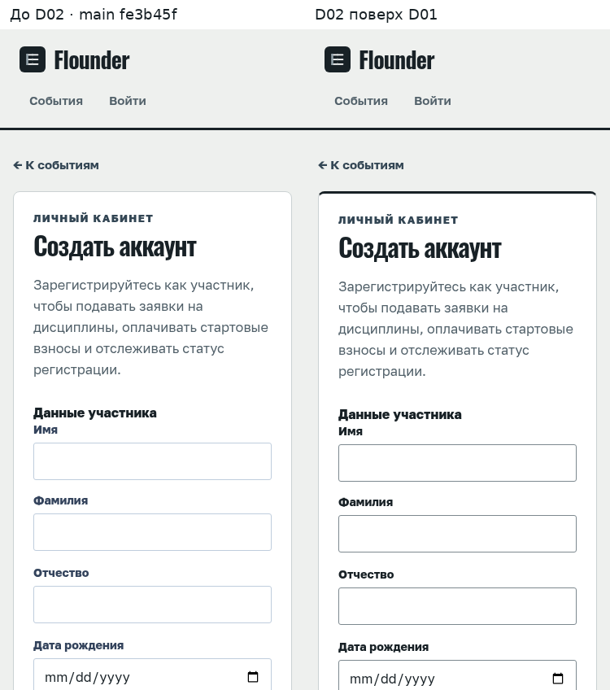
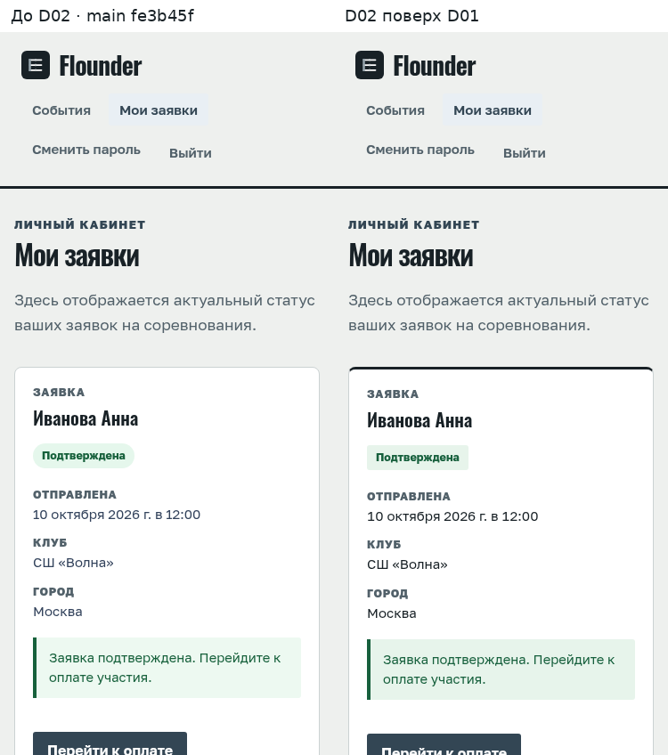
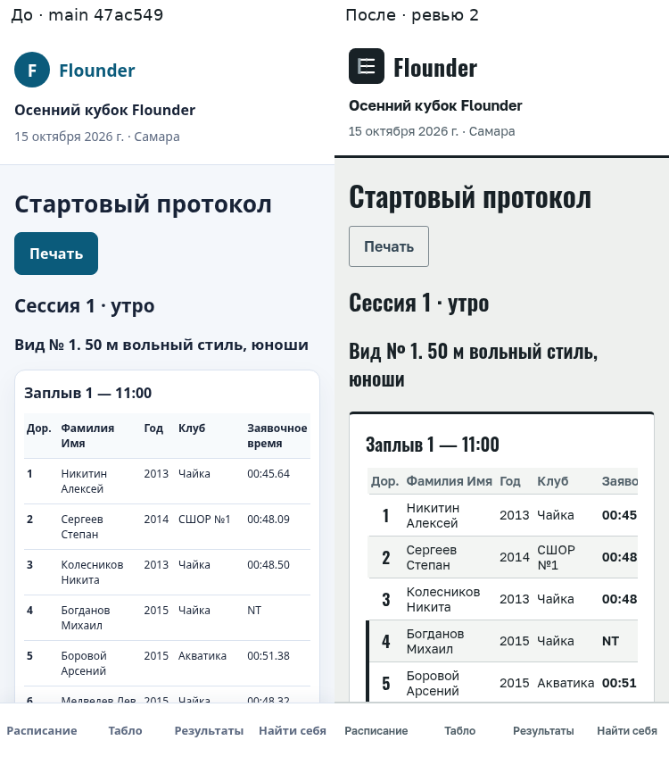
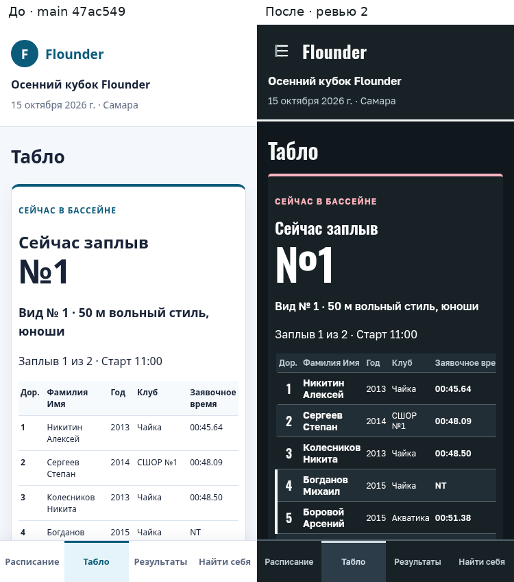
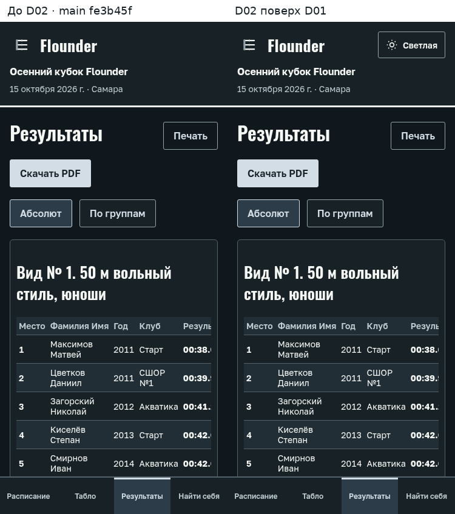
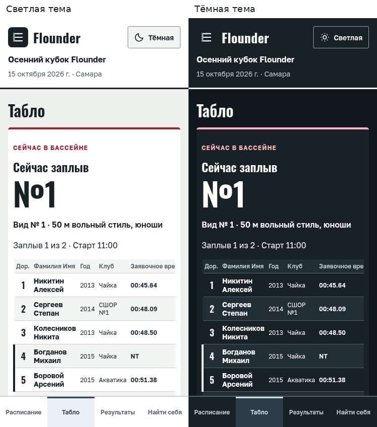
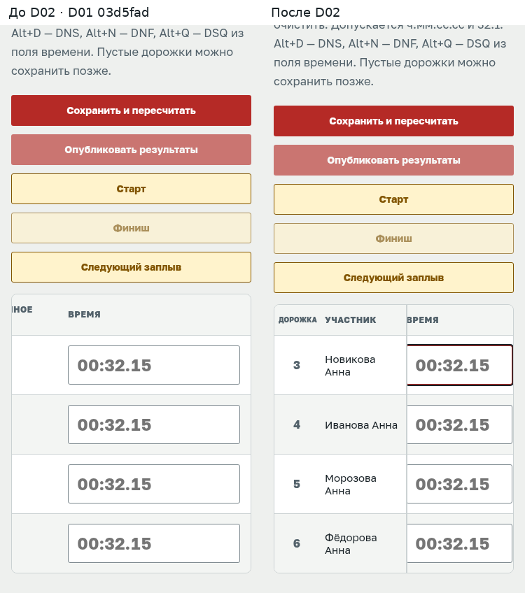

# SportGate — инструкция для родителей, спортсменов и судей

Версия: 15.10.2026. Все названия кнопок и статусов взяты из интерфейса без изменений. В шапке сайта пока показано старое имя «Flounder» — переименование в SportGate идёт отдельно; здесь везде написано SportGate.

Если какой-то функции в интерфейсе ещё нет, рядом написано **«пока через организатора»** — напишите или позвоните организатору соревнования, он сделает это за вас.

## Оглавление

**Часть 1. Родитель и участник**
1. [Что можно без входа](#1-что-можно-без-входа)
2. [Регистрация и вход](#2-регистрация-и-вход)
3. [Восстановление и смена пароля](#3-восстановление-и-смена-пароля)
4. [Профиль спортсмена и несколько детей](#4-профиль-спортсмена-и-несколько-детей)
5. [Как подать заявку](#5-как-подать-заявку)
6. [Документы](#6-документы)
7. [Статусы заявки и письма](#7-статусы-заявки-и-письма)
8. [Лист ожидания](#8-лист-ожидания)
9. [Оплата участия](#9-оплата-участия)
10. [Стартовый протокол и своё время старта](#10-стартовый-протокол-и-своё-время-старта)
11. [Табло в день соревнования](#11-табло-в-день-соревнования)
12. [Результаты](#12-результаты)
13. [Тёмная и светлая тема](#13-тёмная-и-светлая-тема)
14. [Установка на телефон (PWA)](#14-установка-на-телефон-pwa)

**Часть 2. Судья**
15. [Вход и панель судьи](#15-вход-и-панель-судьи)
16. [Ввод времени, DNS / DNF / DSQ](#16-ввод-времени-dns--dnf--dsq)
17. [Старт, финиш, публикация, следующий заплыв](#17-старт-финиш-публикация-следующий-заплыв)

18. [Таблицы статусов](#18-таблицы-статусов)
19. [FAQ](#19-faq)

---

# Часть 1. Родитель и участник

## 1. Что можно без входа

Главная страница — «Календарь соревнований» с карточками событий (статус, название, «Регистрация: даты», «Дата события») и кнопкой «Подробнее». Страница соревнования (`/e/<код>`) открыта всем:

| Что хотите | Где нажать | Что увидите |
|---|---|---|
| Узнать даты, бассейн, программу | блок «О соревновании», блок «Сессии и виды программы» | даты, «Название бассейна, город», «8 дорожек · бассейн 25 м», список видов по сессиям; если протокол ещё не готов — «Стартовый протокол ещё не опубликован» |
| Посмотреть заплывы и дорожки | карточка «Стартовый протокол →» | см. раздел 10 |
| Посмотреть порядок стартов по времени | карточка «Расписание →» | список «10:03 · Заплыв 2», вид, «Ожидается / Идёт сейчас / Завершён / Отменён» |
| Следить за соревнованием | карточка «Табло →» | см. раздел 11 |
| Итоги | карточка «Результаты →» | см. раздел 12 |

Внизу экрана на телефоне закреплено меню: «Расписание», «Табло», «Результаты», «Найти себя».

Вход нужен только для подачи заявки, просмотра своих заявок и документов.

## 2. Регистрация и вход

**Создать аккаунт:** «Войти» (справа вверху) → ссылка «Создать аккаунт» (или кнопка «Зарегистрироваться» на странице заявки) → форма:
- «Данные участника»: Имя, Фамилия, Отчество, Дата рождения — **это данные спортсмена** (ребёнка), а не родителя.
- «Контакты и вход»: Email, Телефон, Пароль (не менее 8 символов), Повторите пароль.
- «Дополнительно»: Город, Клуб.
- Галочка «Я согласен(на) с правилами платформы и обработкой персональных данных.»
- Кнопка «Создать аккаунт». После создания вход выполняется автоматически.

Если появилось «Спортсмен с такими ФИО, датой рождения и полом уже есть в списке заявок организатора. Для привязки аккаунта обратитесь к организатору.» — организатор уже внёс ребёнка через Excel, и профиль привязан к другому аккаунту. Напишите организатору.

**Войти:** «Войти» → Email, Пароль → «Войти». Ошибка «Проверьте email и пароль.» означает опечатку; «Слишком много попыток входа…» — подождите указанное число минут.

**Выйти:** «Выйти» в верхнем меню.

## 3. Восстановление и смена пароля

- Забыли пароль: на странице входа «Забыли пароль?» → «Восстановить пароль» → Email → «Отправить ссылку». Вы увидите «Если аккаунт с этим email существует, мы отправили ссылку восстановления». В письме — ссылка на страницу «Новый пароль» (Новый пароль, Повторите пароль → «Сохранить пароль»). Если в ссылке нет кода, появится «В ссылке отсутствует токен» и ссылка «Запросить новую ссылку».
- Сменить пароль, зная старый: верхнее меню «Сменить пароль» → Текущий пароль, Новый пароль, Повторите пароль → «Сохранить пароль». После этого вас выйдет из системы: «Пароль изменён. Войдите заново с новым паролем».
- Требования к паролю: не менее 8 символов, буквы и цифры.

Если письмо не приходит — пока через организатора: администратор платформы может задать новый пароль вручную.

## 4. Профиль спортсмена и несколько детей

Отдельной страницы «Профиль» нет. Данные спортсмена (ФИО, дата рождения, пол, клуб) заполняются при регистрации аккаунта и при каждой подаче заявки — форма заявки обновляет профиль.

**Один аккаунт = один спортсмен.** Если в форме заявки указать другого ребёнка, профиль аккаунта будет перезаписан его данными, а прежние заявки останутся с прежним ФИО (снимок сохраняется в заявке). Поэтому для каждого ребёнка создайте отдельный аккаунт с отдельным email. Второй вариант — попросить организатора добавить ребёнка через импорт (пока через организатора).

В «Мои заявки» документы показываются отдельным блоком на каждого спортсмена, по которому у вас есть заявки.

## 5. Как подать заявку

| Шаг | Где | Что увидите |
|---|---|---|
| 1. Найти событие | главная «Календарь соревнований» → «Подробнее» | страница соревнования |
| 2. Нажать «Подать заявку» | блок «О соревновании» | кнопка есть, только пока у события «Регистрация открыта»; иначе текст «Регистрация закрыта» |
| 3. Войти | если не вошли — страница «Войдите или зарегистрируйтесь» с кнопками «Войти» / «Зарегистрироваться» | после входа вернётесь на форму |
| 4. «Данные спортсмена» | Фамилия, Имя, Отчество, Дата рождения, Пол, Клуб / город | подставьте данные ребёнка |
| 5. «Виды программы» | список видов с галочками | показываются только подходящие по полу и году рождения; галочка «Показать все виды» раскрывает остальные с пометкой «Не подходит по полу или году рождения». Рядом с видом — стоимость («Бесплатно» или «500 ₽») |
| 6. Заявочное время | поле под каждым выбранным видом, формат `мм:сс.сс` (например `00:32.15` или просто `32.15`) | подсказка «Укажите заявочное время» (обязательно) или «Можно оставить пустым». Без времени спортсмен ставится в последние заплывы |
| 7. Согласие | галочка «Я даю согласие на обработку персональных данных (демо)» | |
| 8. «Отправить заявку» | | экран «Заявка отправлена» со списком «вид — отправлена» и кнопкой «Мои заявки» |

Ограничения: не больше трёх видов за одну отправку; на один вид — одна активная заявка («Участник уже зарегистрирован в дисциплине»). Если мест нет, вверху формы будет «Мест нет, запись в лист ожидания» (раздел 8).

Отдельное письмо «Заявка принята» придёт на email.

## 6. Документы

«Мои заявки» → блок «Документы» под именем спортсмена.

- Типы: Медицинская справка, Страховка, Согласие родителя, Согласие на обработку ПДн.
- Загрузка: «Тип документа» → «Файл документа» (PDF, JPG или PNG до 10 МБ; с телефона можно сфотографировать) → «Дата выдачи», «Действует до» (необязательно) → «Загрузить документ».
- После загрузки документ получает статус «На проверке». «Скачать» — посмотреть файл; «Удалить» — доступно только пока статус «На проверке».
- Документы видны вам и организаторам соревнований, на которые вы подали заявку. Текст в блоке: «Документы видны вам и организаторам ваших соревнований.»

Статусы документа: «Не загружен», «На проверке», «Принят», «Отклонён» (с причиной). Сейчас проверка документов организатором в интерфейсе не реализована — документ остаётся «На проверке», это нормально и не мешает участию.

## 7. Статусы заявки и письма

«Мои заявки» (`/my/registrations`): карточка на каждую заявку — имя спортсмена, статус, «Отправлена: дата», «Клуб», «Город», подсказка и «Комментарий организатора», если он есть.

| Статус | Подсказка в карточке | Письмо | Что делать |
|---|---|---|---|
| На рассмотрении | «Организатор проверяет данные заявки. Оплата станет доступна после подтверждения.» | «Заявка принята» | ждать |
| Подтверждена | «Заявка подтверждена. Перейдите к оплате участия.» | «Заявка подтверждена» | кнопка «Перейти к оплате», если есть взнос |
| Оплачена | «Оплата участия подтверждена.» | — | ждать стартовый протокол |
| Требует уточнения | «Организатор запросил уточнение данных. Ознакомьтесь с комментарием и свяжитесь с организатором при необходимости.» | — | прочитать «Комментарий организатора» и связаться с организатором: исправить заявку самому пока нельзя (пока через организатора) |
| Отклонена | «Заявка отклонена. Оплата для неё недоступна.» | «Заявка отклонена» (с причиной) | уточнить причину у организатора |
| Лист ожидания | «Вы в листе ожидания. Заявка поступит на рассмотрение, когда освободится место.» | — | ждать (раздел 8) |
| Отменена | «Заявка отменена. Оплата для неё недоступна.» | — | — |

Снять свою заявку из интерфейса пока нельзя — пока через организатора (кнопка «Снять» у него). Кроме писем о заявке приходят «Стартовый протокол опубликован» (если вы попали в заплыв) и «Результаты опубликованы» (по вашему заплыву). Письма приходят, только если организатор не отключил их и на сервере настроена почта.

## 8. Лист ожидания

У соревнования, вида или возрастной группы может быть лимит. Когда места закончились, на странице события появляется «Мест нет, запись в лист ожидания», а рядом с видом в форме — та же пометка. Заявку всё равно можно отправить: она получит статус «Лист ожидания».

Очередь двигается автоматически: когда кто-то снимается, отклоняется или организатор повышает лимит, первая заявка в очереди переходит в «На рассмотрении» и вы получите письмо «Заявка принята». Организатор может также подтвердить вас вне лимита. Пока заявка в листе ожидания, в заплывы она не попадает.

## 9. Оплата участия

Если у вида есть взнос: после статуса «Подтверждена» в карточке появляется «Перейти к оплате» → страница «Оплата заявки» → «Создать платёж» → «Перейти к оплате» (ЮKassa) либо ожидание ручного подтверждения оператором («Платёж создан. После оплаты дождитесь подтверждения оператором.»). Статусы платежа: «Платёж создан», «Ожидает оплаты», «Ожидает подтверждения», «Оплата подтверждена», «Платёж отменён», «Ошибка оплаты», «Средства возвращены». При «Бесплатно» оплата не требуется.

## 10. Стартовый протокол и своё время старта

Страница «Стартовый протокол» (`/e/<код>/start-list`) появляется после публикации организатором (до этого — «Стартовый протокол ещё не опубликован.»). Структура: сессия → «Вид № 3. 50 м вольный стиль, девушки» → «Заплыв 2 — 10:03» → таблица Дорожка / Фамилия Имя / Год / Клуб / Заявочное время. Снятые участники помечены «Снят». Кнопки «Печать» и «Скачать PDF».

Самый быстрый способ узнать своё время старта — «Найти себя» (нижнее меню или блок на странице «Табло»): введите не менее двух букв фамилии → карточка спортсмена: «Год · Клуб» и по каждому виду «Заплыв 2 · дорожка 4 · 10:03». Время показано в часовом поясе бассейна; под страницей «Расписание» есть пояснение «Время старта ориентировочное. Текущий заплыв выделен.»

Письмо «Стартовый протокол опубликован» содержит ссылку на протокол.

## 11. Табло в день соревнования

«Табло» (`/e/<код>/live`) обновляется само каждые 5 секунд («Обновлено: 10:41 · каждые 5 секунд»):
- «Сейчас в бассейне»: «Сейчас заплыв №…», вид, «Заплыв N из M · Старт 10:03», ссылка «Открыть заплыв» (дорожки). Если пауза — «Сейчас нет активного заплыва».
- «Далее» — ближайшие заплывы с временем. При опоздании графика появляется «Соревнование идёт с задержкой N мин, время рассчитано с учётом задержки» и у заплывов пометка «Расчётное время старта». Если организатор перенёс расписание, на «Расписании» будет «Расписание сдвинуто в ЧЧ:ММ».
- «Найти себя» — поиск по фамилии (раздел 10); после финиша здесь же появится «Результат: 00:32.15 · место 3 · место в группе 1» или «Результат ещё не опубликован».

Если пропала связь, вверху появится «Нет связи, показаны последние данные. Табло обновится после подключения.»

## 12. Результаты

«Результаты» (`/e/<код>/results`): переключатель «Абсолют» / «По группам», по каждому виду таблица Место / Фамилия Имя / Год / Клуб / Результат. Вместо времени может стоять DNS (не стартовал), DNF (не финишировал), DSQ (дисквалифицирован). Пока ничего не опубликовано — «Результаты ещё не опубликованы.» Кнопки «Печать» и «Скачать PDF» (итоговый протокол). Результаты появляются по заплывам сразу после публикации судьёй; если судья исправил результат, таблица обновится (PDF — с задержкой до минуты).

Письмо «Результаты опубликованы» приходит по вашему заплыву.

## 13. Тёмная и светлая тема

На публичных страницах соревнования (`/e/…`) в шапке есть кнопка «Тёмная» / «Светлая». По умолчанию: «Табло» и «Результаты» открываются в тёмной теме (удобно у бассейна), остальные — по настройке телефона. Выбор запоминается в браузере. Личный кабинет и страницы входа всегда светлые.

## 14. Установка на телефон (PWA)

Сайт можно добавить на экран телефона как приложение:
- Android / Chrome: откройте страницу соревнования → меню браузера → «Установить приложение» (или «Добавить на главный экран»).
- iPhone / Safari: «Поделиться» → «На экран «Домой»».

Приложение открывается без адресной строки, хранит последние загруженные страницы соревнования и показывает их при отсутствии связи. PDF офлайн не сохраняются. Иконка и название приложения пока «Flounder» (сменятся вместе с переименованием).

---

# Часть 2. Судья

## 15. Вход и панель судьи

1. Получите у организатора email и пароль; войдите («Войти»). После первого входа смените пароль («Сменить пароль» в верхнем меню).
2. В верхнем меню нажмите «Результаты» (`/operator/results`) → выберите «Событие» → «Вид программы» → «Заплыв» (в списке видно статус, например «Заплыв 2 — Стартовый протокол опубликован») → «Открыть».
3. Откроется «Судейская панель» с названием заплыва и его статусом. Ссылка «← К списку заплывов» возвращает к выбору.

Если списки пусты: «Виды программы пока не добавлены.» / «Заплывы пока не созданы.» — организатор ещё не сформировал или не опубликовал заплывы. Если «У вашей учётной записи нет прав для работы с этими результатами.» — попросите организатора добавить вас в организацию с ролью «Судья».

## 16. Ввод времени, DNS / DNF / DSQ

Таблица: Дорожка / Участник / Заявочное время / Время / Статус / Место / В группе.

- Поле «Время»: вводите цифры подряд `ммсссс` (например `003215` → `00:32.15`) или `32.15`; допускается `1:05.40` и `32.1`. Подсказка над таблицей: «Введите цифры ммсссс или время 32.15. Enter / Tab — следующая дорожка, Esc — очистить…».
- Enter или Tab — переход к следующей дорожке; после последней курсор встаёт на «Сохранить и пересчитать». Esc — очистить поле.
- Кнопки у каждой дорожки: «DNS» (не стартовал), «DNF» (не финишировал), «DSQ» (дисквалифицирован). Повторное нажатие снимает отметку. Горячие клавиши из поля времени: Alt+D, Alt+N, Alt+Q. При отметке поле времени блокируется.
- Ошибка ввода показывается под полем: «Введите время мм:сс.сс (секунды 00–59).»
- Пустые дорожки можно оставить и сохранить позже.

Под кнопками строка состояния: «Есть несохранённые изменения» или «Сохранено 10:42».

## 17. Старт, финиш, публикация, следующий заплыв

| Кнопка | Когда нажимать | Что происходит |
|---|---|---|
| «Старт» | по сигналу стартёра | статус «Идёт заплыв», фиксируется фактическое время старта (по нему табло считает задержку). Сообщение «Заплыв начат.» |
| «Сохранить и пересчитать» | после ввода времён | времена сохранены, заполнены «Место» и «В группе» |
| «Опубликовать результаты» | когда у **всех** дорожек есть время или DNS/DNF/DSQ и всё сохранено | статус «Завершён, результаты опубликованы», результаты видны зрителям, участникам уходит письмо. Сообщение «Результаты опубликованы.» |
| «Финиш» | когда заплыв закончен | статус завершён, табло переходит к следующему заплыву. Сообщение «Заплыв завершён.» |
| «Следующий заплыв» | чтобы открыть следующий по расписанию | открывается следующая панель; табло обновляется. Если появится «Следующий заплыв открыт, но табло не обновлено…» — нажмите ещё раз или сообщите организатору |

Рекомендуемый порядок на каждом заплыве: «Старт» → ввод времён → «Сохранить и пересчитать» → «Опубликовать результаты» → «Финиш» → «Следующий заплыв».

Пока есть несохранённые изменения, кнопки «Опубликовать результаты», «Старт», «Финиш», «Следующий заплыв» неактивны — сначала сохраните.

Судья не может снимать результаты с публикации и править уже опубликованный заплыв (поля станут недоступны). Исправления после публикации делает секретарь или организатор: у исправленной строки появится пометка «исправлено».

---

## 18. Таблицы статусов

**Событие:** Черновик → Опубликовано → Регистрация открыта → Регистрация закрыта → Идёт соревнование → Завершено → Архив.

**Заявка:** Лист ожидания · На рассмотрении · Подтверждена · Оплачена · Требует уточнения · Отклонена · Отменена (у организатора ещё «Снята», «Допущена»).

**Документ:** Не загружен · На проверке · Принят · Отклонён.

**Платёж:** Платёж создан · Ожидает оплаты · Ожидает подтверждения · Оплата подтверждена · Платёж отменён · Ошибка оплаты · Средства возвращены.

**Заплыв:** Черновик · Запланирован · Стартовый протокол опубликован · Идёт заплыв · Завершён, результаты опубликованы · Завершён · Отменён.

**Результат:** время `мм:сс.сс` · DNS · DNF · DSQ · «исправлено» (CORRECTED).

## 19. FAQ

**Нет кнопки «Подать заявку».** Регистрация ещё не открыта или уже закрыта — на странице написано «Регистрация закрыта». Следите за датами в карточке события.

**Не вижу нужный вид в форме.** Вид не подходит по полу или году рождения ребёнка (проверьте «Пол» и «Дата рождения»), либо организатор его ещё не опубликовал. Поставьте «Показать все виды», чтобы убедиться.

**Ошиблись в заявочном времени или ФИО.** Исправить самостоятельно пока нельзя — напишите организатору (пока через организатора).

**Хочу отменить участие.** Пока через организатора — он нажмёт «Снять».

**Как узнать, во сколько плывёт ребёнок?** «Найти себя» → фамилия. Время в часовом поясе бассейна и может сдвигаться — смотрите «Табло» в день старта.

**Результат на табло есть, а в письме нет.** Письма приходят с задержкой до нескольких минут и только если организатор их не отключил.

**Можно ли одним аккаунтом заявить двух детей?** Нет, нужен отдельный аккаунт на каждого (раздел 4).

**Телефон показывает «Нет связи, показаны последние данные».** Это нормально при плохом интернете у бассейна: данные обновятся, когда связь появится.
