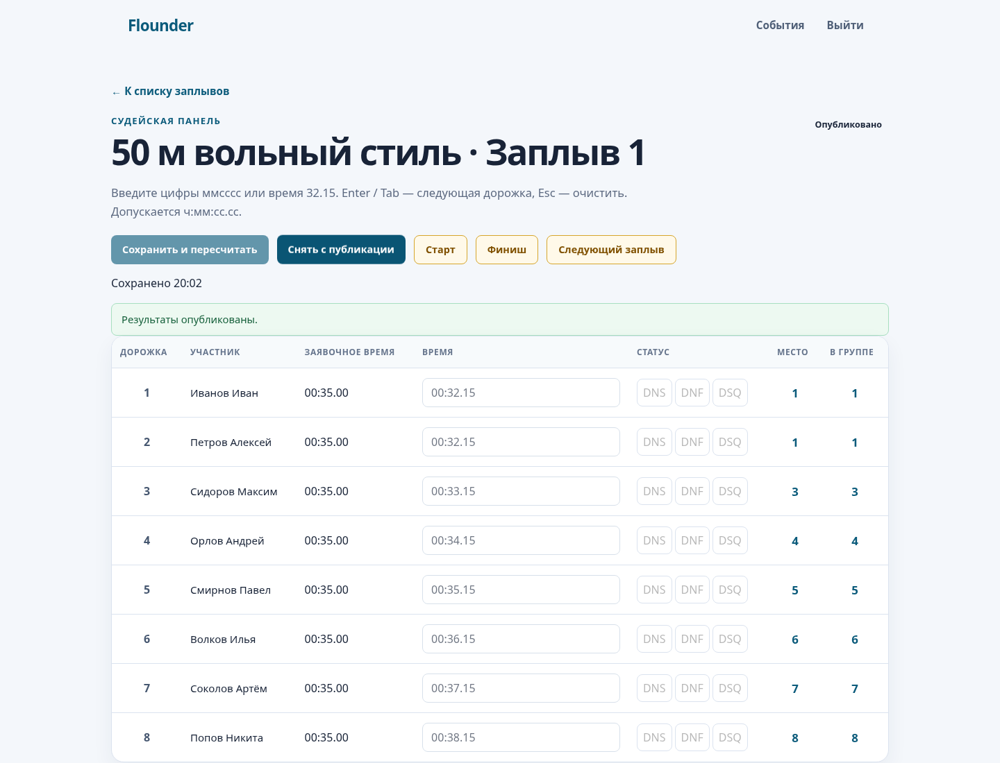

# T08 · Поток C · Панель ввода результатов и публикация (frontend + мелкий backend)

Прочитай `AGENTS.md`, `docs/02_ТЗ_демо.md` §4.8, §5.6, §6.2. Ветка `feat/T08-judge-panel` от `main` (не зависит от T04; backend-часть — после T03). Срок: 13.10.

## Контекст
Существует `features/results/JudgePanelPage` (`/operator/competition-units/:unitId`): ввод `rawValue`, статусы, кнопки пересчёта и публикации; `api/results.api.ts`. Время сейчас — произвольная строка; ничьи не учитываются; `h:mm:ss` не поддерживается.

## Что сделать
1. **Поле времени**: маска `мм:сс.сс` (ввод цифр, автоподстановка `:` и `.`), допускается ввод `32.15` → `00:32.15`; валидация до отправки; Enter/Tab → следующая дорожка; Esc — очистить. Кнопки-статусы `DNS`, `DNF`, `DSQ` переключают строку (время блокируется). Отображать заявочное время рядом для контроля ввода.
2. **Сохранение**: `POST /api/v1/competition-units/{unitId}/results` одним запросом со всеми строками (контракт §5.6) → таблица с местами (`finalPlace`, `placeInAgeGroup`) обновляется без перезагрузки; индикатор «сохранено HH:MM».
3. **Публикация** заплыва (существующий `publication`) и кнопка «Следующий заплыв» (переход к следующему по `scheduled_at` в том же событии; если бэкенд не отдаёт — по `sequence_number` внутри дисциплины), «Старт/Финиш» → `POST /competition-units/{id}/start|finish` (контракт §5.7).
4. **Список заплывов для оператора**: заменить страницу с ручным вводом UUID дисциплины (`/operator/results`) на выбор события → вида → заплыва (селекты, данные из существующих эндпоинтов организатора; доступ operator/judge — убедиться, что `GET /api/v1/organizer/events` разрешён этим ролям или добавить `GET /api/v1/events/accessible` на бэкенде с `assertCanManage`-фильтром).
5. **Backend-минимум** (если T03 ещё не слит — согласовать с автором T03, чтобы не дублировать): парсер времени, `time_ms`, `place_in_age_group`, ничьи (1,1,3), DNS/DNF/DSQ без мест — всё описано в T03 п. 8; здесь — только фронт, а backend-правки делать лишь если T03 к 13.10 вечера не слит.
6. Клавиатурный сценарий целиком (без мыши): 8 дорожек вводятся за ≤ 40 с.

## Критерии приёмки
- Ввод 8 результатов + сохранение + публикация на моках и на живом бэкенде; ошибки формата показываются рядом с полем.
- Скриншот панели в PR; `npm run build`/`lint` чистые.

## Реализация потока C и проверка

Фронтенд использует пакетный POST §5.6, отображает finalPlace/placeInAgeGroup из ответа, поддерживает маску, секунды/часы, ошибки возле поля, Enter/Tab/Esc, DNS/DNF/DSQ, entryTime, публикацию и start/finish. Выбор события → вида → заплыва заменяет ручной UUID. Следующий заплыв выбирается по scheduledAt события или sequenceNumber вида; при известном eventId выполняется PUT live. Маршруты результатов открыты operator/judge/organizer/admin.

Проверка вручную:

1. Войти, открыть `/operator/results`, выбрать событие, вид и заплыв.
2. Ввести восемь времён цифрами `003215` с Enter/Tab. Проверить `32.15`, `1:02:03.45`, Esc и ошибку для `00:61.00`.
3. Переключить DNS/DNF/DSQ: время блокируется; повторное нажатие возвращает обычный результат.
4. Сохранить: один POST для всех строк, обновление обоих мест, «Сохранено HH:MM». Равные времена отображают серверные места 1,1,3.
5. Опубликовать, проверить блокировку ввода, снять публикацию; проверить старт/финиш и следующий заплыв с обновлением live.

Валидация: build/lint проходят, новые экраны без предупреждений; существующие предупреждения остальных файлов не менялись. Chromium на моках проверил весь сценарий выше. Автоматический ввод восьми дорожек и сохранение занимают около 1–2 секунд, скорость работы человека не измерялась. Полный mvn test блокируется отсутствием Docker; unit/architecture/JWT проходят с `-Dtest='*Test,!*IntegrationTest,!UserControllerTest'` и Mockito javaagent вместо ограниченного self-attach.

Миграции/backend не менялись согласно промпту потока C. Проверка на живом backend ожидает поток A: в текущем main отсутствуют §5.6 и live/start/finish, entryTime и возрастные места; organizer/events и events/{id} закрыты для operator/judge. Прямая ссылка без eventId использует последовательность внутри вида и не обновляет live.

### Вопросы для техдиректора

- Подтвердить ответ пакетного POST как CompetitionUnitDetailsResponse с entries, display/rawValue, finalPlace и placeInAgeGroup и имя заявочного времени entryTime.
- Обеспечить в потоке A доступ operator/judge к управляемым событиям с EventAccessService-фильтром и eventId в деталях заплыва для прямых ссылок.
